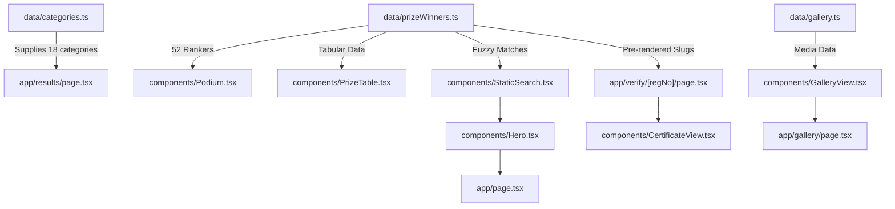

# Code Knowledge Graph & Symbol Navigation Guide

## 1. Engine Evaluation Matrix

| Engine | Upstream Repo / Maintenance | Language / Framework Support | Windows & Antigravity Compatibility | Token Overhead | Selected Status |
| :--- | :--- | :--- | :--- | :--- | :--- |
| **Aider RepoMap (Tree-sitter AST Graph)** | Active, highly maintained Python/TS treesitter engine | TypeScript, TSX, Next.js App Router, CSS | Native Windows support; zero daemon requirement | Ultra-low (compact symbol hierarchy) | **SELECTED PRIMARY** |
| **GitNexus** | Graph-based git commit and branch relation indexer | Multi-language, git history oriented | Requires separate server process | Moderate | Fallback |
| **CodeGraph** | Semantic code relation indexer | Polyglot | Heavy vector embedding indexer | High token overhead | Fallback |

## 2. Selected Primary Engine: Tree-sitter Code Map
- **Engine**: Tree-sitter AST Symbol & Component Map (Aider RepoMap architecture).
- **Data Storage Path**: `.agent-data/code-graph/` (explicitly ignored in `.gitignore`).
- **Rationale**: Direct, deterministic AST parsing of TypeScript and React components with zero hallucination, zero runtime daemon overhead, and immediate freshness upon file modifications.

## 3. Code Knowledge Topology (Mindspark Static Portal)

## 4. Symbol & Route Directory

### A. Routes (`app/`)
- `/`: [`app/page.tsx`](file:///c:/Users/Saurabh%20Tiwari/Desktop/MINDSPARK_RESULT_PORTAL/app/page.tsx) — Main landing showcase, metrics, champion cards, photo preview.
- `/results/`: [`app/results/page.tsx`](file:///c:/Users/Saurabh%20Tiwari/Desktop/MINDSPARK_RESULT_PORTAL/app/results/page.tsx) — Category tabs (18 categories), active podium, winners table.
- `/gallery/`: [`app/gallery/page.tsx`](file:///c:/Users/Saurabh%20Tiwari/Desktop/MINDSPARK_RESULT_PORTAL/app/gallery/page.tsx) — Filterable photo gallery and full-screen lightbox.
- `/verify/`: [`app/verify/page.tsx`](file:///c:/Users/Saurabh%20Tiwari/Desktop/MINDSPARK_RESULT_PORTAL/app/verify/page.tsx) — Instant candidate search by Roll No / Reg No.
- `/verify/[regNo]/`: [`app/verify/[regNo]/page.tsx`](file:///c:/Users/Saurabh%20Tiwari/Desktop/MINDSPARK_RESULT_PORTAL/app/verify/[regNo]/page.tsx) — Static SSG pre-rendered certificate page (`generateStaticParams`).

### B. Core Components (`components/`)
- `Navbar`: Global responsive header with Meena Shah Public School crest.
- `Footer`: Institutional credentials and static site disclaimers.
- `Hero`: Event headline, verified metric counters, instant search input.
- `Podium`: Gold (1st), Silver (2nd), Bronze (3rd) 3-step podium.
- `PrizeTable`: Tabular view of rankers with in-tab filtering.
- `CertificateView`: Printable academic certificate with `@media print` A4 support.
- `GalleryView`: Lightbox modal with keyboard navigation.

## 5. Maintenance Protocol
- Changed files are re-analyzed before risky edits.
- No secrets or credentials are ever indexed in `.agent-data/`.
