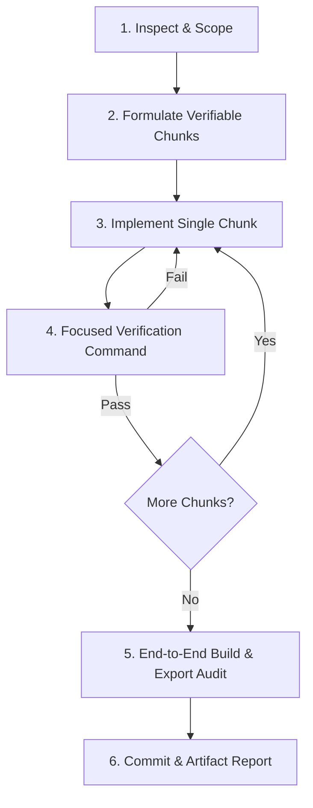

# Implementation Workflow & Task Chunking Protocol

## 1. Local Workflow Specification (Phase 8)
In the absence of a third-party task-chunking repository URL (`PENDING USER INPUT`), all tasks are governed by this standardized local engineering protocol.

## 2. Standard Chunk Anatomy
Every substantial modification or feature implementation must define:
1. **Goal**: Precise, measurable architectural or UI objective.
2. **Affected Areas**: Exact file paths and component symbols.
3. **Dependencies**: Upstream interfaces or parent components impacted.
4. **Acceptance Criteria**: Concrete functional and visual test criteria.
5. **Verification Command**: Exact terminal command (e.g. `npm run build`, `npm run lint`).

## 3. Verified Execution Record for Mindspark Static Portal

### Chunk 1: Project Scaffolding & Static Configuration
- **Goal**: Initialize clean Next.js 14 App Router project with 100% static export (`output: 'export'`) and Tailwind CSS.
- **Affected Files**: `package.json`, `tsconfig.json`, `next.config.mjs`, `tailwind.config.ts`, `postcss.config.mjs`, `app/globals.css`.
- **Verification**: `npm install` exited 0; lockfile created cleanly.

### Chunk 2: Data Models & Static Datasets
- **Goal**: Formulate typed static datasets for 18 categories, 52 awarded rankers, and 12 gallery media records.
- **Affected Files**: `types/index.ts`, `data/categories.ts`, `data/prizeWinners.ts`, `data/gallery.ts`.
- **Verification**: Strict TypeScript type checking passed without errors.

### Chunk 3: Reusable UI Component Suite
- **Goal**: Build modular components following WCAG 2.2 AA and strict Lucide icon rules.
- **Affected Files**: `components/Navbar.tsx`, `Footer.tsx`, `Hero.tsx`, `StaticSearch.tsx`, `Podium.tsx`, `PrizeTable.tsx`, `CertificateView.tsx`, `GalleryView.tsx`.
- **Verification**: Component compilation and syntax validation passed.

### Chunk 4: Route Architecture & Pre-rendered Certificates
- **Goal**: Build App Router pages including `/`, `/results`, `/gallery`, `/verify`, and `/verify/[regNo]` with `generateStaticParams()`.
- **Affected Files**: `app/layout.tsx`, `app/page.tsx`, `app/results/page.tsx`, `app/gallery/page.tsx`, `app/verify/page.tsx`, `app/verify/[regNo]/page.tsx`, `app/not-found.tsx`.
- **Verification**: `npm run build` generated 59 static HTML pages into `out/`.

### Chunk 5: Engineering Governance & Master Documentation
- **Goal**: Complete all 10 engineering governance files and `AGENTS.md` per Antigravity Master Agent Setup v2.
- **Affected Files**: `AGENTS.md`, `docs/engineering/*.md`.
- **Verification**: Cross-referenced all requirements against PDF and master prompt specifications.

